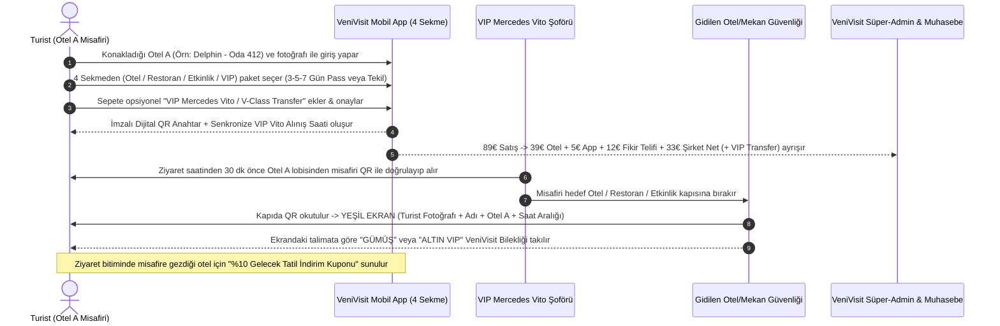

# 🛡️ VeniVisit (bir ChamoX Ürünü)
### Oteller Arası Dijital & Giyilebilir Geçiş, Restoran/Etkinlik Keşif ve VIP Mobilite Ekosistemi

> **"Kulaktan kulağa değil, GÖZ GÖZE deneyim."**  
> Bölgedeki 5 yıldızlı otellerde konaklayan doğrulanmış turistlerin; anlaşmalı **Otelleri, Restoranları, Etkinlikleri ve VIP Deneyimleri** belirlenen saat aralıklarında ziyaret etmesini, sepetlerine **VIP Mercedes Vito / V-Class Transfer** eklemesini ve gittikleri tesiste **Yüksek Güvenlikli Fotoğraflı QR Doğrulaması + Gidilen Tesiste Verilen Renk Kodlu Fiziksel Bileklik (Gümüş / Altın)** ile ağırlanmasını sağlayan B2B2C Turizm Süper-Uygulaması.

---

## 📚 Dokümantasyon ve Mimari Rehberler

Projenin tüm derin araştırması, veritabanı/API mimarisi, 4 kişilik ekip dağılımı ve yapay zeka ajan (subagent) talimatları aşağıdaki dokümanlarda detaylandırılmıştır:

1. 📈 **[01 — Derin Pazar Araştırması, Vizyon ve İş Modeli (`docs/01-RESEARCH-AND-VISION.md`)](./docs/01-RESEARCH-AND-VISION.md)**
   * Lara–Kundu bölgesi problemi, ResortPass / Dayuse karşılaştırması, 89 € birim ekonomisi (Otel Payı, App Gideri, Fikir Telifi, Şirket Net Karı) ve kesinleşen v2.1 ürün kuralları.
2. 🏗️ **[02 — Teknik Sistem Mimarisi, Veri Şeması ve API Kontratları (`docs/02-SYSTEM-ARCHITECTURE-AND-SCHEMA.md`)](./docs/02-SYSTEM-ARCHITECTURE-AND-SCHEMA.md)**
   * Birleşik TypeScript/PostgreSQL veri şeması (`GuestUser`, `Venue`, `ExperiencePackage`, `PassBooking`, `AccessKey`, `VIPTransferOrder`, `CommissionSplitRecord`) ve REST API uç noktaları.
3. 👥 **[03 — 4 Kişilik Ekip Görev Dağılımı ve Ajan Kullanım Rehberi (`docs/03-4-PERSON-TEAM-AND-AGENT-PLAYBOOK.md`)](./docs/03-4-PERSON-TEAM-AND-AGENT-PLAYBOOK.md)**
   * 4 geliştiricinin çakışma yaşamadan paralel çalışacağı klasör sınırları, Git branch stratejisi ve ajan orkestrasyon sırası.

---

## 🤖 5 Uzman Yapay Zeka Ajanı (Subagents) ve 4 Kişilik Ekip Eşleşmesi

Bu proje, **4 ekip üyesinin** kendi sorumluluk alanındaki **5 uzman yapay zeka ajanını** sırasıyla veya paralel çalıştırması için tasarlanmıştır:

| Ekip Üyesi | Sorumlu Olduğu Alan | Çalıştıracağı Ajan Prompt Dosyaları |
| :--- | :--- | :--- |
| **👤 1. KİŞİ** *(Backend, Güvenlik & Fintech)* | • Ortak Veri Modeli & Sabitler • İmzalı QR/NFC Token & Sunucu Saat Kontrolü • Kayıp Anahtar İptali (`REVOKED`) • 89€ Çoklu Komisyon & Telif Motoru | • [`agents/01-product-architect.md`](./agents/01-product-architect.md) • [`agents/02-backend-security-fintech.md`](./agents/02-backend-security-fintech.md) |
| **👤 2. KİŞİ** *(4 Sekmeli Pazaryeri & VIP Transfer)* | • 4 Ana Sekme (`Oteller`, `Restoranlar`, `Etkinlik & Gece Hayatı`, `VIP Deneyimler`) • Hibrit Paket (`3/5/7 Gün Pass` + `Tekil`) & Kontenjan • **VIP Mercedes Vito / V-Class** Saat Senkronizasyonu • Ziyaret Sonu **%10 Gelecek Tatil İndirim Kuponu** | • [`agents/03-marketplace-mobility.md`](./agents/03-marketplace-mobility.md) |
| **👤 3. KİŞİ** *(Turist Mobil Uygulaması UI/UX)* | • Doğrulanmış Otel A Misafir Profili • 4 Sekmeli Lüks Keşif Vitrini • Hibrit Paket + Opsiyonel VIP Vito Sepeti • Canlı QR Anahtar, Geri Sayım, Kayıp Butonu & Tatil Teklifi | • [`agents/04-tourist-mobile-app.md`](./agents/04-tourist-mobile-app.md) |
| **👤 4. KİŞİ** *(Operasyon Panelleri & Canlı Demo)* | • **Güvenlik QR Tarayıcı PWA:** Fotoğraflı Yeşil/Kırmızı Ekran + `ALTIN / GÜMÜŞ BİLEKLİK VERİNİZ` talimatı • **VIP Vito Şoför Ekranı** • **Süper-Admin Ciro & Komisyon Paneli** • **6 Dakikalık Yatırımcı Demo Simülatörü** | • [`agents/05-partner-portals-and-qa.md`](./agents/05-partner-portals-and-qa.md) |

---

## 🔄 Uçtan Uca VeniVisit Operasyon Akışı

---

## 📂 Referans Proje Dosyaları

* 📄 [`örnek plan.txt`](./%C3%B6rnek%20plan.txt) — Orijinal buluş özeti, demo senaryosu ve teknik gereksinimler.
* 📊 [`VeniVisit Projekt presentation.pdf`](./VeniVisit%20Projekt%20presentation.pdf) — İş modeli, Lara–Kundu pazar analizi ve Euro bazlı kazanç projeksiyonu sunumu.
* 🎨 [`LOGO farbig.pdf`](./LOGO%20farbig.pdf) & [`Untitled-5.pdf`](./Untitled-5.pdf) — VeniVisit orijinal vektörel logo dosyaları.
* 🎬 [`WhatsApp Video 2026-10-27 at 19.11.57.mp4`](./WhatsApp%20Video%202026-10-27%20at%2019.11.57.mp4) — VeniVisit animasyon tanıtım videosu.
