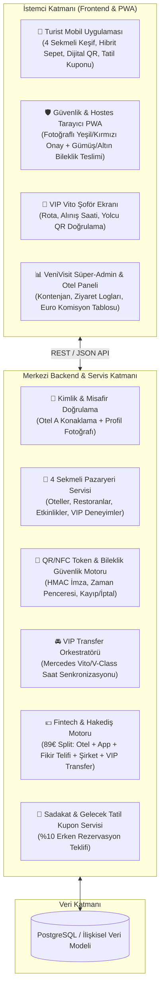

# VeniVisit — Teknik Sistem Mimarisi, Veri Şeması ve API Kontratları

Bu doküman, 4 kişilik geliştirici ekibimizin ve 5 uzman yapay zeka ajanımızın kodlama ve tasarım sırasında ortak "Tek Doğru Kaynak" (Single Source of Truth) olarak kullanacağı teknik spesifikasyondur.

---

## 1. Yüksek Seviye Sistem Mimarisi



---

## 2. Birleşik Veritabanı Şeması (Domain Data Model)

Tüm ekip üyelerinin (Backend, Frontend, Mobil, Admin) kullanacağı standart veri yapıları:

### 2.1. Temel Enum Tipleri
```typescript
// Uygulama içi 4 Ana Kategori Sekmesi
export enum VenueCategory {
  HOTEL = 'HOTEL',                     // 1. Oteller (Havuz, Plaj, Spa, Aquapark, Keşif)
  RESTAURANT = 'RESTAURANT',           // 2. Restoranlar (A La Carte, Fine Dining, Tadım)
  EVENT_NIGHTLIFE = 'EVENT_NIGHTLIFE', // 3. Etkinlik & Gece Hayatı (Şov, Konser, Beach Club, Tema Park)
  VIP_EXPERIENCE = 'VIP_EXPERIENCE'    // 4. VIP Deneyimler (Özel Kabana, Loca, VIP Spa)
}

// Satış & Paket Tipi (Hibrit Model)
export enum BookingMode {
  MULTI_DAY_PASS = 'MULTI_DAY_PASS',   // 3, 5 veya 7 Günlük VeniVisit Pass
  SINGLE_VISIT = 'SINGLE_VISIT'        // Tekil Otel / Restoran / Etkinlik Rezervasyonu
}

// Gidilen Tesiste Verilecek Fiziksel Bileklik Kademesi
export enum WristbandTier {
  SILVER = 'SILVER', // 🥈 GÜMÜŞ BİLEKLİK: Keşif, Standart Plaj & Havuz Geçişi
  GOLD = 'GOLD'      // 🥇 ALTIN VIP BİLEKLİK: Her Şey Dahil, A La Carte & VIP Alanlar
}

// Dijital QR Anahtar Durumu
export enum AccessKeyStatus {
  ACTIVE = 'ACTIVE',     // Aktif ve kullanılabilir
  REVOKED = 'REVOKED',   // Kayıp/Çalıntı bildirildi ve iptal edildi
  EXPIRED = 'EXPIRED',   // Zaman penceresi doldu
  USED = 'USED'          // Tek kullanımlık giriş tamamlandı
}

// VIP Transfer Durumu
export enum TransferStatus {
  NONE = 'NONE',
  SCHEDULED = 'SCHEDULED',         // Rezerve edildi, saat bekliyor
  DRIVER_EN_ROUTE = 'DRIVER_EN_ROUTE', // VIP Vito Otel A lobisine geliyor
  GUEST_PICKED_UP = 'GUEST_PICKED_UP', // Misafir QR ile doğrulandı ve araca bindi
  ARRIVED_AT_VENUE = 'ARRIVED_AT_VENUE', // Hedef otele/mekana ulaşıldı
  RETURN_COMPLETED = 'RETURN_COMPLETED'  // Dönüş transferi tamamlandı
}
```

### 2.2. Ana Tablolar (Entities)

#### 1. `GuestUser` (Doğrulanmış Turist)
| Alan | Tip | Açıklama |
| :--- | :--- | :--- |
| `id` | `UUID` | Tekil kullanıcı kimliği |
| `full_name` | `string` | Misafirin adı ve soyadı (Güvenlik ekranında görünür) |
| `photo_url` | `string` | **Zorunlu:** Yüksek güvenlikli kapı doğrulaması için misafir fotoğrafı |
| `origin_hotel_id` | `UUID` | Konakladığı ana otel (Örn: Delphin Imperial) |
| `origin_room_number` | `string` | Konakladığı oda numarası (Örn: "412") |
| `nationality` | `string` | Ülke / Dil tercihi (DE, EN, RU, TR) |
| `stay_check_in` | `Date` | Ana oteline giriş tarihi |
| `stay_check_out` | `Date` | Ana otelinden çıkış tarihi |

#### 2. `Venue` (Oteller, Restoranlar, Etkinlikler, VIP Deneyimler)
| Alan | Tip | Açıklama |
| :--- | :--- | :--- |
| `id` | `UUID` | Mekan/Tesis kimliği |
| `name` | `string` | Örn: "Concorde De Luxe Resort", "Cullinan Beef Grill Club" |
| `category` | `VenueCategory` | `HOTEL` \| `RESTAURANT` \| `EVENT_NIGHTLIFE` \| `VIP_EXPERIENCE` |
| `region` | `string` | Örn: "Lara - Kundu, Antalya" |
| `description` | `string` | Konsept açıklaması ve öne çıkan özellikler |
| `gallery_urls` | `string[]` | Yüksek çözünürlüklü görseller |
| `coordinates` | `{lat, lng}` | VIP transfer mesafe ve süre hesabı için konum |
| `daily_quota` | `number` | Günlük maksimum VeniVisit ziyaretçi kontenjanı |
| `future_stay_discount_pct` | `number` | Ziyaret sonrası sunulacak gelecek tatil indirim oranı (Örn: `10` = %10) |

#### 3. `ExperiencePackage` (Satın Alınabilir Paketler & Seanslar)
| Alan | Tip | Açıklama |
| :--- | :--- | :--- |
| `id` | `UUID` | Paket kimliği |
| `venue_id` | `UUID` | İlgili mekan (Çoklu Pass ise `null` veya ağ geneli) |
| `title` | `string` | Örn: "Günübirlik Havuz & Spa + A La Carte", "3 Günlük Lara VIP Pass" |
| `booking_mode` | `BookingMode` | `MULTI_DAY_PASS` (3/5/7 gün) veya `SINGLE_VISIT` |
| `duration_days` | `number` | Tekil ise `1`, Pass ise `3`, `5` veya `7` |
| `visit_start_time` | `string` | Örn: `"14:00"` veya akşam etkinliği için `"20:00"` |
| `visit_end_time` | `string` | Örn: `"18:00"` veya `"23:30"` |
| `wristband_tier` | `WristbandTier` | Gidilen yerde verilecek bileklik: `SILVER` veya `GOLD` |
| `base_price_eur` | `number` | Paket baz fiyatı (Örn: `89` €) |
| `vip_vito_addon_price_eur` | `number` | Opsiyonel Çift Yön VIP Mercedes Vito eklenti fiyatı (Örn: `35` €) |
| `included_perks` | `string[]` | Örn: `["Ana Havuz & Plaj", "Spa Kullanımı", "1x A La Carte İkram"]` |

#### 4. `PassBooking` (Misafirin Satın Aldığı Aktif Rezervasyon)
| Alan | Tip | Açıklama |
| :--- | :--- | :--- |
| `id` | `UUID` | Rezervasyon kimliği |
| `guest_id` | `UUID` | Satın alan misafir |
| `package_id` | `UUID` | Seçilen paket |
| `target_venue_id` | `UUID` | Ziyaret edilecek hedef otel/restoran/etkinlik |
| `visit_date` | `string` | Ziyaret tarihi (`YYYY-MM-DD`) |
| `valid_from` | `ISO8601` | Sunucu bazlı başlangıç zamanı |
| `valid_until` | `ISO8601` | Sunucu bazlı bitiş zamanı |
| `wristband_tier` | `WristbandTier` | `SILVER` veya `GOLD` |
| `wristband_issued_at` | `ISO8601?` | Kapıda fiziksel bilekliğin teslim edildiği an |
| `wristband_serial_id` | `string?` | Teslim edilen fiziksel bilekliğin NFC/seri kodu |
| `has_vip_transfer` | `boolean` | Sepete VIP Mercedes Vito eklendi mi? |
| `status` | `string` | `ACTIVE` \| `CHECKED_IN` \| `COMPLETED` \| `CANCELLED` |

#### 5. `AccessKey` (Dinamik QR Anahtar & Kayıp Yönetimi)
| Alan | Tip | Açıklama |
| :--- | :--- | :--- |
| `id` | `UUID` | Anahtar kimliği |
| `booking_id` | `UUID` | Bağlı olduğu rezervasyon |
| `signed_token` | `string` | HMAC/JWT imzalı güvenlik dizgesi (QR içinde taşınır) |
| `status` | `AccessKeyStatus` | `ACTIVE` \| `REVOKED` \| `EXPIRED` |
| `issued_at` | `ISO8601` | Üretim zamanı |
| `revoked_at` | `ISO8601?` | Kayıp bildirimiyle iptal edildiği zaman |
| `revoked_reason` | `string?` | Örn: `"LOST_BY_GUEST"` |

#### 6. `VIPTransferOrder` (VIP Mercedes Vito / V-Class Taşımacılık)
| Alan | Tip | Açıklama |
| :--- | :--- | :--- |
| `id` | `UUID` | Transfer emri kimliği |
| `booking_id` | `UUID` | Bağlı olduğu ziyaret rezervasyonu |
| `vehicle_model` | `string` | `"Mercedes-Benz VIP Vito / V-Class"` |
| `vehicle_plate` | `string` | Örn: `"07 VV 2026"` |
| `driver_name` | `string` | Şoför adı-soyadı |
| `driver_phone` | `string` | Şoför iletişim |
| `pickup_location` | `string` | Örn: `"Delphin Imperial Ana Lobi VIP Çıkışı"` |
| `dropoff_location` | `string` | Örn: `"Concorde De Luxe Resort VIP Girişi"` |
| `scheduled_pickup_time` | `string` | Ziyaret başlangıcından 30 dk önce (Örn: `"13:30"`) |
| `scheduled_return_time` | `string` | Ziyaret bitiş saati (Örn: `"18:00"`) |
| `status` | `TransferStatus` | Canlı transfer durumu |

#### 7. `CommissionSplitRecord` (Euro Bazlı Otomatik Hakediş Defteri)
| Alan | Tip | Açıklama |
| :--- | :--- | :--- |
| `id` | `UUID` | Muhasebe kaydı kimliği |
| `booking_id` | `UUID` | İlgili satış |
| `gross_package_eur` | `number` | Paket tutarı (Örn: `89.00` €) |
| `vip_transfer_eur` | `number` | Varsa VIP Transfer tutarı (Örn: `35.00` € veya `0`) |
| `total_charged_eur` | `number` | Müşteriden tahsil edilen toplam |
| `destination_venue_share_eur` | `number` | Gidilen otele/mekana ayrılan pay (Örn: `39.00` €) |
| `app_infra_cost_eur` | `number` | Uygulama ve altyapı gider payı (Örn: `5.00` €) |
| `idea_royalty_share_eur` | `number` | Fikir telif payı (Örn: `12.00` €) |
| `vip_fleet_share_eur` | `number` | Transfer filosuna ayrılan pay (Örn: `28.00` €) |
| `venivisit_net_profit_eur` | `number` | Şirkete kalan net kar (Örn: `33.00` € + transfer komisyonu) |

---

## 3. Kritik API Uç Noktaları (REST Endpoints)

### A. Keşif & Rezervasyon (Kişi 2 & Kişi 3)
* `GET /api/v1/venues?category=HOTEL|RESTAURANT|EVENT_NIGHTLIFE|VIP_EXPERIENCE`
  * Seçilen sekmedeki tesisleri, müsait kontenjanları ve paketleri döner.
* `POST /api/v1/bookings/checkout`
  * **İstek:** `{ guestId, packageId, targetVenueId, visitDate, includeVipVitoTransfer, passengerCount }`
  * **İşlem:** Kontenjanı düşer, `PassBooking` oluşturur, imzalı `AccessKey` (QR) üretir, `includeVipVitoTransfer: true` ise ziyaret saatinden 30 dk öncesine `VIPTransferOrder` atar ve `CommissionSplitRecord` tablosuna Euro bazlı gelir dağılımını yazar.

### B. Yüksek Güvenlikli QR Doğrulama & Bileklik Teslimi (Kişi 1 & Kişi 4)
* `POST /api/v1/security/verify-qr`
  * **İstek:** `{ signedToken, scannerVenueId, simulatedServerTime? }`
  * **Kontroller:**
    1. Token imzası geçerli mi?
    2. `AccessKey.status === 'ACTIVE'` mi? (`REVOKED` ise **KIRMIZI: "KAYIP / İPTAL EDİLMİŞ ANAHTAR"** döner).
    3. Okutulan mekan `targetVenueId` ile eşleşiyor mu? (Eşleşmiyorsa **KIRMIZI: "GEÇERSİZ OTEL/MEKAN"** döner).
    4. Sunucu saati `valid_from` ile `valid_until` arasında mı? (Değilse **KIRMIZI: "SÜRE DIŞI ZİYARET SAATİ"** döner).
  * **Başarılı Yanıt (YEŞİL EKRAN):**
    ```json
    {
      "decision": "VALID",
      "guest": {
        "fullName": "Elena & Lukas Weber",
        "photoUrl": "/assets/guests/weber-couple.jpg",
        "originHotelName": "Delphin Imperial Lara",
        "originRoomNumber": "412"
      },
      "visit": {
        "venueName": "Concorde De Luxe Resort",
        "timeWindow": "14:00 - 18:00",
        "packageTitle": "Günübirlik Havuz, Spa & A La Carte Deneyimi",
        "wristbandInstruction": {
          "tier": "GOLD",
          "badgeText": "ALTIN VIP BİLEKLİK VERİNİZ",
          "alreadyIssued": false
        }
      }
    }
    ```
* `POST /api/v1/security/confirm-wristband`
  * Güvenlik görevlisi misafire fiziksel bilekliği taktığında onaylar; `wristband_issued_at` kaydedilir ve içerideki aktif misafir sayacı güncellenir.

### C. Kayıp Anahtar / Bileklik İptali (Kişi 1 & Kişi 3)
* `POST /api/v1/passes/:bookingId/report-lost`
  * Eski `AccessKey.status = 'REVOKED'` yapılır, saniyesinde yeni `signed_token` üretilir ve `LostReport` kaydı düşülür.

### D. Ziyaret Sonu Gelecek Tatil Kuponu (Kişi 2 & Kişi 3)
* `POST /api/v1/loyalty/claim-future-stay-offer`
  * Ziyaret tamamlandığında misafire gezdiği otel için `%10 VeniVisit Erken Rezervasyon İndirim Kodu` üretir ve Admin panelindeki dönüşüm metriklerine ekler.
