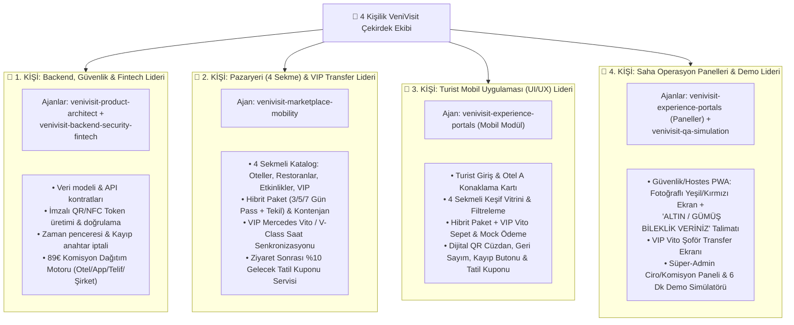

# VeniVisit — 4 Kişilik Ekip Görev Dağılımı ve Ajan (Subagent) Kullanım Rehberi

Bu proje **4 kişilik bir yazılım/tasarım ekibi** tarafından, her ekip üyesinin kendi uzmanlık alanındaki **Yapay Zeka Ajanlarını (Subagents)** yönetmesiyle geliştirilmek üzere kurgulanmıştır.

---

## 1. 4 Kişilik Görev ve Ajan Dağılım Matrisi

Çakışma (merge conflict) yaşanmaması için proje **4 bağımsız modüle** bölünmüştür:



---

## 2. Kişi Bazlı Detaylı Sorumluluklar ve Dosya Sınırları

### 👤 1. KİŞİ: Çekirdek Backend, QR/NFC Güvenlik ve Fintech Lideri
* **Yöneteceği Ajanlar:** `venivisit-product-architect` ve `venivisit-backend-security-fintech`
* **Ajan Prompt Dosyaları:** [`agents/01-product-architect.md`](../agents/01-product-architect.md) ve [`agents/02-backend-security-fintech.md`](../agents/02-backend-security-fintech.md)
* **Çalışacağı Klasörler:** `src/core/`, `src/security/`, `src/fintech/`, `src/types/`
* **Teslim Edeceği Çıktılar:**
  1. Tüm ekibin ortak kullanacağı TypeScript veri modelleri (`src/types/venivisit.types.ts`).
  2. Sunucu saati bazlı QR doğrulama motoru (`verifyQrToken`): Geçerli saatte Yeşil + Misafir Fotoğrafı + Ana Otel bilgisi + Gümüş/Altın Bileklik talimatı; süre dışında veya yanlış otelde Kırmızı karar dönen servis.
  3. Kayıp/Çalıntı Anahtar (`reportLostKey`) servisi: Eski QR'ı anında `REVOKED` yapıp yeni token üreten akış.
  4. Euro bazlı Komisyon ve Hakediş Motoru (`calculateCommissionSplit`): 89 € paketi (39 € Otel, 5 € App, 12 € Fikir Telifi, 33 € Şirket Net) + VIP Vito transfer paylarını kuruşu kuruşuna bölen servis.

---

### 👤 2. KİŞİ: 4 Sekmeli Pazaryeri (Otel/Restoran/Etkinlik/VIP) ve VIP Mobilite Lideri
* **Yöneteceği Ajan:** `venivisit-marketplace-mobility`
* **Ajan Prompt Dosyası:** [`agents/03-marketplace-mobility.md`](../agents/03-marketplace-mobility.md)
* **Çalışacağı Klasörler:** `src/marketplace/`, `src/mobility/`, `src/loyalty/`, `src/data/`
* **Teslim Edeceği Çıktılar:**
  1. Lara–Kundu bölgesine ait zengin mekan ve paket kataloğu (`1-Oteller`, `2-Restoranlar`, `3-Etkinlik & Gece Hayatı`, `4-VIP Deneyimler`).
  2. Hibrit rezervasyon servisi: Hem 3/5/7 günlük Pass hem tekil ziyaret paketleri ve günlük kontenjan kontrolü.
  3. **VIP Mercedes Vito / V-Class Senkronizasyon Motoru:** Seçilen ziyaret saatine göre (örn. 14:00–18:00) otomatik olarak 13:30 Otel A lobisinden alış ve 18:00 Otel B kapısından dönüş transfer emri oluşturan servis.
  4. **Gelecek Tatil Sadakat Motoru:** Ziyaret bittiğinde misafire gezdiği otel için `%10 VeniVisit Erken Rezervasyon Kuponu` üreten servis.

---

### 👤 3. KİŞİ: Turist Mobil Deneyimi (Guest Super-App UI/UX) Lideri
* **Yöneteceği Ajan:** `venivisit-experience-portals` (Mobil Uygulama Görevi)
* **Ajan Prompt Dosyası:** [`agents/04-tourist-mobile-app.md`](../agents/04-tourist-mobile-app.md)
* **Çalışacağı Klasörler:** `src/views/tourist-app/`, `src/components/tourist/`
* **Teslim Edeceği Çıktılar:**
  1. **Üst/Alt Bar ve Profil:** Misafirin konakladığı ana otel (örn. *Delphin Imperial - Oda 412*) ve doğrulanmış fotoğraflı profili.
  2. **4 Sekmeli Keşif Vitrini:** `Oteller` | `Restoranlar` | `Etkinlik & Gece Hayatı` | `VIP Deneyimler` arasında akıcı geçiş, paket kartları ve Gümüş/Altın bileklik rozetleri.
  3. **Hibrit Paket & VIP Vito Sepeti:** 3/5/7 gün veya tekil seçim + tek tıkla *"VIP Mercedes Vito / V-Class Transfer Ekle (Gidiş-Dönüş Otomatik Senkronize)"* kutucuğu + 2 saniyelik Mock Ödeme.
  4. **Canlı Dijital QR Anahtar & VIP Transfer Kartı:** Büyük imzalı QR kod, geri sayım sayacı, VIP Vito plaka/şoför/alınış saati kartı, *"Anahtarımı Kaybettim"* butonu ve ziyaret sonu *"%10 Gelecek Tatil İndirim Kuponu"* ekranı.

---

### 👤 4. KİŞİ: Saha Operasyon Panelleri (Güvenlik, VIP Şoför, Admin) ve Canlı Demo Lideri
* **Yöneteceği Ajanlar:** `venivisit-experience-portals` (Operasyon Panelleri Görevi) ve `venivisit-qa-simulation`
* **Ajan Prompt Dosyası:** [`agents/05-partner-portals-and-qa.md`](../agents/05-partner-portals-and-qa.md)
* **Çalışacağı Klasörler:** `src/views/security-scanner/`, `src/views/vip-driver/`, `src/views/super-admin/`, `src/simulation/`
* **Teslim Edeceği Çıktılar:**
  1. **Güvenlik & Hostes QR Tarayıcı (PWA):**
     * **YEŞİL EKRAN:** Misafirin büyük fotoğrafı, adı-soyadı, geldiği ana otel/oda, geçerlilik saati ve dev rozetle **`🥇 ALTIN VIP BİLEKLİK VERİNİZ`** veya **`🥈 GÜMÜŞ BİLEKLİK VERİNİZ`** uyarısı + *"Fiziksel Bileklik Teslim Edildi"* onay butonu.
     * **KIRMIZI EKRANLAR:** *"SÜRE DIŞI ZİYARET"*, *"ANAHTAR İPTAL EDİLMİŞ (KAYIP)"*, *"GEÇERSİZ OTEL/MEKAN"*.
  2. **VIP Mercedes Vito Şoför Ekranı:** Atanan transferler, alınacak otel lobisi, saat ve misafir QR doğrulama.
  3. **VeniVisit Süper-Admin & Gelir Paneli:** Sunumdaki Euro bazlı hakediş tablosu (Satış Fiyatı, Otel Payı, App Gideri, Fikir Telif Payı, VIP Filo Payı ve Şirket Net Karı), canlı ziyaret logları ve gelecek tatil kupon dönüşümleri.
  4. **6 Dakikalık Yatırımcı Demo Kontrol Çubuğu (Simulation Bar):** Sunum sırasında ekranın üstünden tek tıkla saat dilimini değiştirip (14:30 Geçerli Saat vs. 19:30 Süre Dışı) tüm paneller arasında canlı geçiş sağlayan simülatör.

---

## 3. Git Branch (Dal) Stratejisi ve Çalışma Sırası

4 kişi aynı anda veya sırayla çalışırken şu Git akışını kullanacaktır:

```bash
# 1. Herkes projeyi klonlar
git clone https://github.com/kaanboztas/venivisit.git
cd venivisit

# 2. Her ekip üyesi kendi dalını (branch) açar:
git checkout -b feat/p1-core-security-fintech     # 1. Kişi
git checkout -b feat/p2-marketplace-vip-mobility  # 2. Kişi
git checkout -b feat/p3-tourist-mobile-ui         # 3. Kişi
git checkout -b feat/p4-partner-portals-demo      # 4. Kişi
```

### Önerilen Ajan Çalıştırma Sırası
1. **Faz A (Temel Kontratlar):** Önce **1. Kişi** (`01-product-architect` & `02-backend-security-fintech`) ve **2. Kişi** (`03-marketplace-mobility`) kendi ajanlarını çalıştırarak veri modellerini, Lara–Kundu mekan verilerini, QR doğrulama ve VIP Vito transfer servislerini oluşturur.
2. **Faz B (Arayüzler ve Demo):** Ardından **3. Kişi** (`04-tourist-mobile-app`) ve **4. Kişi** (`05-partner-portals-and-qa`) kendi ajanlarını çalıştırarak Turist Mobil Uygulamasını, Fotoğraflı Güvenlik Tarayıcısını, VIP Şoför Ekranını ve Admin Ciro Panelini bağlar.
